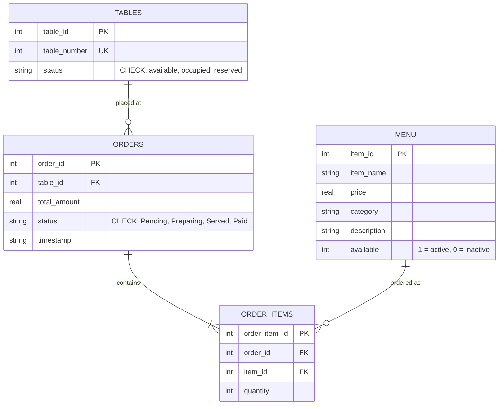

# 🍽️ RestaurantQR – Digital Restaurant Management System

A full-stack, contactless **Restaurant Management & QR Ordering System** designed for a Database Management Systems (DBMS) course project. Built with **Python Flask**, **SQLite**, **Bootstrap 5**, and dynamic **QR Code generation**.

---

## 📌 Project Overview

**RestaurantQR** provides a seamless digital dining workflow:
- **Customers** scan a QR code placed on their table using any smartphone camera, browse a categorized digital menu, add items to a cart, and place orders directly to the kitchen without waiting for waitstaff.
- **Restaurant Staff / Admins** view live orders on a dashboard, update kitchen statuses in real-time, manage menu availability, and track total revenue.
- **DBMS Viva / Demonstration Ready:** Includes an integrated **Live SQL Query Viewer** and interactive SQL console showing every statement (`SELECT`, `INSERT`, `UPDATE`, `JOIN`, constraints, aggregates) running in real-time.

---

## 🚀 Key Features

### 👨‍🍳 Customer Workflow
- **QR-Based Table Access:** Each table (1–10) has a dedicated QR code linking directly to `/menu/<table_number>`.
- **Digital Interactive Menu:** Grouped into categories (*Starters*, *Main Course*, *Breads*, *Desserts*, *Beverages*) with quick filtering tabs.
- **Session-Based Cart:** Add items, adjust quantities, delete items, or clear cart with instant total calculations.
- **Automated Ordering:** Placing an order calculates subtotal, 5% GST, updates table status to `occupied`, and records individual items in the database.
- **Digital Bill & Receipt:** Itemized receipt with print-ready view and live status tracker (*Pending* → *Preparing* → *Served* → *Paid*).

### 🛠️ Admin & Kitchen Dashboard
- **Live Orders Overview:** Track orders categorized by status with revenue summaries.
- **Status Workflow:** Transition orders through `Pending` ➔ `Preparing` ➔ `Served` ➔ `Paid`.
- **Auto Table Release:** Marking an order as `Paid` automatically resets the table status back to `available`.
- **Menu Inventory Control:** Easily toggle dish availability on or off.
- **QR Code Center:** View, preview, and download high-resolution QR codes for each table.

### 🗄️ DBMS Examiner & Viva Features
- **Live SQL Query Viewer (`/admin/sql`):** Captures and displays every SQL query executed during app usage with syntax highlighting, timestamps, and parameters.
- **Schema Explorer:** Live inspection of all table schemas, data types, primary keys, and foreign keys.
- **Interactive Query Console:** Run custom queries (e.g., `JOIN`, `GROUP BY`, `COUNT`, `SUM`) with instant tabular results.
- **CLI Inspection Scripts:** Standalone terminal scripts for schema review and queries.

---

## 🏗️ Technology Stack

| Component | Technology |
| :--- | :--- |
| **Backend Framework** | Python 3, Flask 3.x |
| **Database** | SQLite 3 (`restaurant.db`) |
| **Templating Engine** | Jinja2 |
| **Frontend UI** | HTML5, CSS3, Bootstrap 5.3, Bootstrap Icons |
| **QR Code Engine** | `qrcode[pil]`, `Pillow` |

---

## 📊 Database Schema & Design

The database consists of 4 normalized relational tables with Foreign Keys and `CHECK` constraints:



---

## 📁 Directory Structure

```text
mini project/
│
├── app.py                  # Main Flask application and database initialiser
├── requirements.txt        # Python package dependencies
├── restaurant.db           # SQLite database file
│
├── inspect_db.py           # CLI script: Inspects tables and schemas
├── run_query.py            # CLI script: Runs multi-table JOIN query
├── revenue_query.py        # CLI script: Aggregates total paid revenue
│
├── static/
│   ├── css/
│   │   └── style.css       # Custom dark theme styles & animations
│   └── qrcodes/            # Auto-generated QR code PNGs for each table
│
├── templates/
│   ├── base.html           # Main layout template (navbar, footer, CDN links)
│   ├── index.html          # Homepage with table cards & links
│   ├── menu.html           # Customer menu page with category filters
│   ├── cart.html           # Cart review and order placement
│   ├── bill.html           # Customer receipt with live status tracker
│   ├── admin.html          # Admin orders dashboard
│   ├── admin_menu.html     # Menu management (toggle availability)
│   ├── admin_qrcodes.html  # QR code download and test center
│   ├── admin_sql.html      # Live SQL query logger and interactive console
│   ├── order_detail.html   # Detailed order view for staff
│   └── error.html          # Error handler view
│
└── README.md               # Project documentation
```

---

## ⚙️ Installation & Running Locally

### 1. Clone or Open the Project
Open PowerShell or your preferred terminal in the project directory:
```powershell
cd "c:\Users\Amrit Prasad\Documents\Sem 4\dbms\mini project"
```

### 2. Activate the Virtual Environment
```powershell
# Create virtual environment (if not already created)
python -m venv venv

# Activate on PowerShell
.\venv\Scripts\Activate.ps1

# (Or on Command Prompt)
# .\venv\Scripts\activate.bat
```

> **Note:** If PowerShell displays a script execution policy restriction, run:
> `Set-ExecutionPolicy -Scope Process -ExecutionPolicy Bypass`

### 3. Install Dependencies
```powershell
pip install -r requirements.txt
```

### 4. Run the Application
```powershell
python app.py
```

On first run, the system automatically creates the database tables, seeds initial menu items and tables, and generates QR code images in `static/qrcodes/`.

---

## 🌐 Application Endpoints

| URL Path | Name | Description |
| :--- | :--- | :--- |
| `http://127.0.0.1:5000/` | **Home** | Table overview, QR preview, and quick navigation |
| `http://127.0.0.1:5000/menu/<table_num>` | **Menu** | Table-specific food ordering page (e.g., `/menu/1`) |
| `http://127.0.0.1:5000/cart/<table_num>` | **Cart** | Cart management & order checkout |
| `http://127.0.0.1:5000/bill/<order_id>` | **Receipt** | Itemized bill with print button & status tracker |
| `http://127.0.0.1:5000/admin` | **Dashboard** | Kitchen order queue & status updater |
| `http://127.0.0.1:5000/admin/menu` | **Menu Admin** | Toggle dishes on/off |
| `http://127.0.0.1:5000/admin/qrcodes` | **QR Codes** | Downloadable QR codes for each table |
| `http://127.0.0.1:5000/admin/sql` | **SQL Viewer** | Live executed queries, schema inspection & query console |

---

## 💻 Standalone CLI Helper Scripts

For terminal demonstrations or testing without opening a browser:

```powershell
# Display all tables and column types
python inspect_db.py

# Query joined order items and menu details
python run_query.py

# Calculate total revenue from paid orders
python revenue_query.py
```

---

## 🎓 DBMS Concepts Demonstrated

1. **DDL (Data Definition Language):** `CREATE TABLE`, `PRIMARY KEY AUTOINCREMENT`, `FOREIGN KEY ... REFERENCES`, `UNIQUE`, `CHECK` constraints.
2. **DML (Data Manipulation Language):** `INSERT INTO`, `UPDATE ... SET`, `DELETE`.
3. **Complex Queries:**
   - Inner joins across multiple tables (`orders`, `order_items`, `menu`, `tables`).
   - Aggregate functions: `SUM()`, `COUNT()`, `COALESCE()`.
   - Conditional grouping and sorting: `GROUP BY status`, `ORDER BY timestamp DESC`.
4. **Data Integrity & Normalization:** Relational design ensuring data consistency across orders, order items, and tables.
